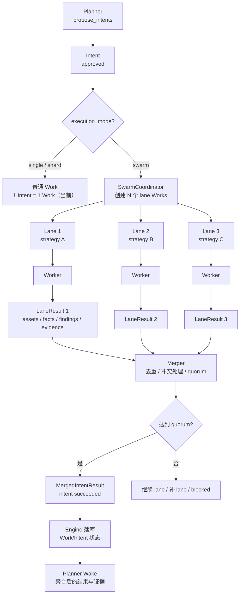
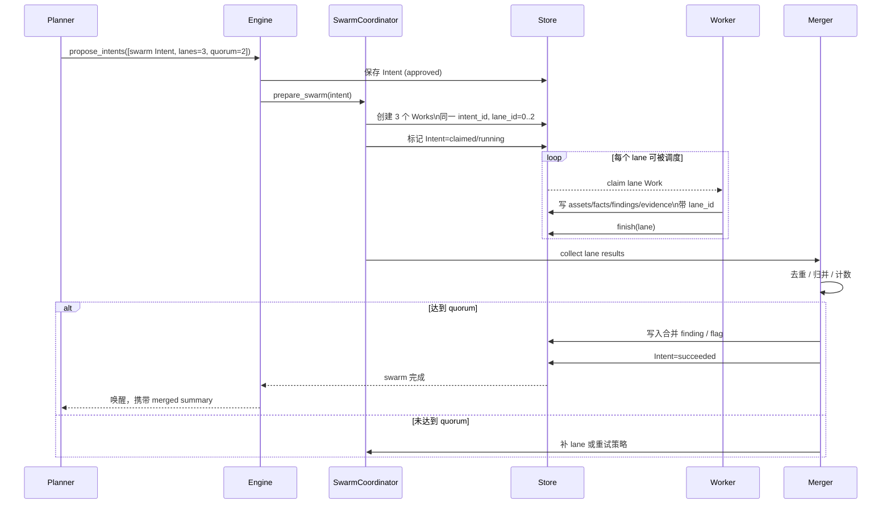

# Swarm 调度设计

> 状态：Phase 3 核心已实现（lane / lane brief / merge / quorum / planner 聚合）；Planner 选择 swarm 后总是由 swarm_lead 生成 lane plan；达到 quorum 后可等待 running lane，并由 drain window 处理。
> 当前实现：swarm Intent 会创建 N 个 lane Works，全部 lane 结束后合并；普通 Intent 仍是 1 个 Work。

## 1. 总览



## 2. 调度时序



## 3. 状态机

### Intent

```text
proposed
  → approved
  → swarm_preparing
  → swarm_running
  → swarm_merging
  → succeeded / failed / blocked
```

### Work（每个 Lane 一个）

```text
queued
  → leased
  → running
  → settling
  → succeeded / failed / timed_out / cancelled
```

关键约束：

- 同一个 Intent 只允许一个 swarm 协调器。
- 普通 Intent 仍走 `1 Intent = 1 Work`。
- lane Work 不能重复创建；用 `(intent_id, lane_id)` 唯一约束。
- 审批仍只发生在 Intent 层；lane 继承 Intent 的授权。
- 取消 swarm 时取消所有 lane，并 drain。

## 4. Quorum 与合并

### 输入

每个 lane 返回：

```json
{
  "lane_id": "lane-1",
  "status": "done",
  "assets": [],
  "facts": [],
  "findings": [],
  "evidence": [],
  "flags": ["flag{...}"]
}
```

### 合并规则

1. **Assets**
   - 按全局 canonical key 去重。
   - 多个 lane 记录同一资产时合并来源。

2. **Facts**
   - 按 `normalize(summary + evidence)` 的哈希去重。
   - 冲突事实保留双方，标记 `conflict=true`。

3. **Findings**
   - 按 `title + evidence` 指纹去重。
   - 同一 flag 多个 lane 命中时合并。

4. **Flags**
   - 按 flag hash 分组。
   - 每组统计 lane 数。
   - `count >= quorum` → 进入 confirmed finding。
   - 未达到 quorum → 标记 candidate，不提交。

5. **Conflict**
   - 同一目标出现不同 flag → 交给 `swarm_lead` 或人工。
   - 不自动随机选一个。

### Quorum 伪代码

```text
group = flags.group_by(hash)

for each flag hash:
    lane_count = distinct lanes reporting flag
    if lane_count >= quorum:
        confirmed_flags.add(flag)
    elif lane_count >= 1:
        candidate_flags.add(flag)

if confirmed_flags:
    write merged finding(s)
    intent = succeeded
else:
    intent = blocked or retry with new lanes
```

## 5. 调度器改动

当前：

```text
ClaimNextIntent()
  → 一个 Intent 创建一个 Work
```

目标：

```text
SwarmCoordinator
  → 创建 N 个 Works，共享 intent_id
  → ClaimNextLaneWork()
  → Worker 执行
  → LaneResultStore
  → Merger / Quorum
  → 一个 MergedIntentResult
```

### Work 表

已有：

```text
works.intent_id
works.lane_id
```

需要补充：

```text
works.swarm_id       -- 协调器实例
works.strategy       -- 该 lane 的策略
works.quorum_group   -- 用于统计
UNIQUE(intent_id, lane_id)
```

### Intent budget

```json
{
  "lanes": 3,
  "quorum": 2,
  "strategies": [
    "source-review",
    "dynamic-exploit",
    "differential-test"
  ],
  "max_lane_minutes": 8
}
```

## 6. 并发与资源

- 全局 `MaxWorkers` 限制所有 Worker。
- 单个 swarm 的 lanes 不能超过剩余 Worker 配额。
- CTF 容器上限（例如 3）是独立资源信号量，不能只靠 Worker 数量。
- lane 排队时状态为 `queued`，不占 Worker。
- 一个 lane 失败不立即终止 swarm；由 quorum 决定。
- 所有 lane 失败才把 Intent 标为 failed/blocked。
- lane 超时由 lease/deadline 控制。

## 7. Planner 唤醒

不能每完成一个 lane 就唤醒 Planner，否则会产生重复 Intent。

推荐：

```text
lane 完成
  → 只写内部 lane 状态
  → 不唤醒 Planner
```

只有：

```text
quorum 达到
或 全部 lane 结束
或 出现高信号 flag
```

才向 Planner 发一个聚合事件：

```json
{
  "type": "swarm.merged",
  "intent_id": 123,
  "lanes_total": 3,
  "lanes_done": 3,
  "quorum": 2,
  "confirmed_flags": ["flag{...}"],
  "candidates": [],
  "facts": 12,
  "findings": 2,
  "conflicts": []
}
```

Planner 看到的仍然是：

```text
一个 Intent 的结果
```

不是：

```text
lane-1、lane-2、lane-3 三个独立 Intent
```

## 8. `swarm_lead`

`swarm_lead` 不是必需的调度器，可以作为：

- 冲突裁决器
- 合并摘要生成器
- 多策略结果解释器

不建议让 `swarm_lead` 直接持有 Worker 生命周期；调度仍由确定性的 `SwarmCoordinator` 负责。

## 9. 最小落地顺序

1. `Works` 支持同 Intent 多 lane + 唯一约束
2. `SwarmCoordinator` 创建/回收 lane
3. lane 结果写入与 `lane_id`
4. Merger 去重 + flag quorum
5. Planner 聚合唤醒
6. `swarm_lead` 冲突裁决
7. 资源信号量 / 容器槽位

## Intent 与 lane 的关系

Planner 一次响应可以创建多个 Intent；一个 `swarm` / `shard` Intent 会创建多个 lane Works。不是每个 lane 一个 Intent。

## Phase 4 延期项

当前 lane 是一个 Work；失败重试、暂停/恢复、多次 attempt、lane 级审计统一延期到 Phase 4，通过 `LaneSpec` + `WorkAttempt` 实现。
